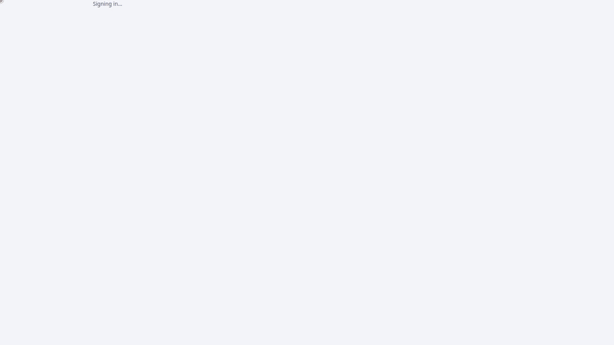

# AgentCanvas

[](https://github.com/marunsct/AgentCanvas/actions/workflows/ci.yml)
[](https://marunsct.github.io/AgentCanvas/)
[](docs/user-guide/licensing.md)

**Draw an AI agent workflow, run and debug it, then take it with you as code for the framework you choose.**

A visual canvas for agentic workflows: drag blocks, wire them up, press **▶ Run** and watch each step light up. Behind
the picture is a real project for **LangGraph** (with LangChain and Deep Agents), the **OpenAI Agents SDK**,
**CrewAI**, **Google ADK**, **Pydantic AI**, **Agno**, **Microsoft Agent Framework**, **Strands**, **LlamaIndex** or
**Mastra** (TypeScript). Switch frameworks with one setting, read the code in the **Code** tab, and export it.

<p align="center">
  
</p>

## Why AgentCanvas

- **Code you can leave with.** Every workflow compiles to an idiomatic project for the framework you pick, with the
  small runtime it needs. Export it, read it, run it without AgentCanvas.
- **One picture, ten frameworks.** Try the same workflow on LangGraph, CrewAI or Pydantic AI before you commit;
  AgentCanvas says what does not carry over.
- **Debug it like code.** Breakpoints, time travel, pinned and mocked steps, cost per step, Explain mode, dry runs
  and tool approvals.
- **Any model, local ones too.** Claude, GPT, Gemini, Mistral, Groq, DeepSeek, Grok, any OpenAI-compatible API, or
  Ollama, LM Studio, vLLM and llama.cpp on your own machine. No key needed to try it: a demo model runs every template.
- **Bring your flows.** Import Langflow, Flowise and n8n exports ([switching](docs/user-guide/switching.md)).
- **Ship it.** Publish a workflow behind an API key, as an MCP server, an A2A agent, an AG-UI endpoint, a chat page
  or a website widget; trigger it from webhooks and schedules.
- **Test it.** Datasets, evaluators, experiments and release gates in the Evaluation Studio.
- **Ready for a team when you are.** Sign-in with your identity provider, organisations, roles, approvals,
  spending caps and an audit log.

Not sure where to start? Describe what you want and the **AI Copilot** builds the workflow, or pick one of 38
[templates](docs/user-guide/templates.md).

## Quick start with Docker

```bash
git clone https://github.com/marunsct/AgentCanvas.git && cd AgentCanvas
make docker-up    # Postgres (pgvector) + migrations + API + web app on http://localhost:7777
```

The image carries every framework (several GB); `FRAMEWORKS=none WITH_MASTRA=false make docker-up` builds a
small one with LangGraph and the OpenAI Agents SDK only.

Open http://localhost:7777 and choose your model on the first-run screen: Claude, GPT, Gemini, Mistral, Groq,
DeepSeek, Grok, any OpenAI-compatible API, or a local model with Ollama, LM Studio, vLLM or llama.cpp. See
[Models and API keys](docs/user-guide/models.md).

## Quick start from source (no API keys needed)

Prerequisites: Python tooling [`uv`](https://docs.astral.sh/uv/), Node 22 + pnpm 10.

```bash
git clone https://github.com/marunsct/AgentCanvas.git && cd AgentCanvas
make setup        # uv sync + pnpm install
make dev-fake     # API with scripted fake models on :8000
make dev-web      # web app on http://localhost:5173 (in another terminal)
```

Step-by-step version with prerequisites, a smoke test and troubleshooting:
[Run AgentCanvas on your computer](docs/user-guide/run-locally.md).

Open the web app and click **Start the guided build** for a six-step tour, or pick a template, press **▶ Run**,
approve the tool call and watch the nodes light up.

Use real models with `make dev-api`, then choose the model and enter its key under **Model** in the web app (or export
provider keys such as `OPENAI_API_KEY` before starting it).

## Deploy

Container images, a production compose file (`infra/compose.prod.yml`, two API replicas behind nginx) and a Helm
chart (`infra/helm/agentcanvas`) are in `infra/`; [Deploy and operate](docs/user-guide/deploy.md) walks through both,
and the [Operations reference](docs/user-guide/operations.md) has the metrics and runbooks.

## Develop

```bash
make test         # backend + frontend tests
make lint         # ruff, pyright, tsc
make e2e          # Playwright end-to-end (starts both servers)
make check        # lint, types, schema drift, tests, build
make ci           # local CI: check + strict docs + audit + Helm (make ci-full: everything incl. Postgres, exports, e2e; make hooks: run lint before push)
make docs         # documentation site on http://localhost:8001
```

The repository map, conventions and CI are in the [handover](docs/developer/handover.md); the
[developer documentation](docs/developer/README.md) maps the rest.

## Documentation

| Documentation | For | Start with |
|---|---|---|
| [User guide](docs/user-guide/index.md) | People who build workflows, and whoever runs AgentCanvas for a team | [Run AgentCanvas on your computer](docs/user-guide/run-locally.md), then [Getting started](docs/user-guide/getting-started.md); operators: [Deploy and operate](docs/user-guide/deploy.md) |
| [Developer documentation](docs/developer/README.md) | People who change AgentCanvas | [Handover](docs/developer/handover.md) (setup, conventions), [status and roadmap](docs/developer/hardening.md), [build guide](docs/developer/build-guide/README.md), [spec](docs/developer/spec/README.md), [ADRs](docs/developer/adr/README.md) |
| [Changelog](CHANGELOG.md) | Everyone | Code at **v0.32.3** plus the unreleased changes at the top; no release has been tagged yet (tags are the owner's call) |

## Community

- **Questions, ideas and things you built:** [Discussions](https://github.com/marunsct/AgentCanvas/discussions).
- **Bugs and feature requests:** [issues](https://github.com/marunsct/AgentCanvas/issues/new/choose).
- **Contributing:** read [CONTRIBUTING](.github/CONTRIBUTING.md); issues labelled
  [good first issue](https://github.com/marunsct/AgentCanvas/labels/good%20first%20issue) are a place to start.
- **Security issues:** report them privately, as [SECURITY](.github/SECURITY.md) says.

If AgentCanvas is useful to you, a ⭐ helps other developers find it.

## License

AgentCanvas is source-available under the [Business Source License 1.1](LICENSE):

- **Free for everyone** to develop, test, evaluate and learn.
- **Free in production** for individuals, organizations with fewer than 250 people and under US$50M revenue, and non-profit or educational non-commercial work, as long as you do not offer AgentCanvas itself as a hosted service.
- **Everyone else** needs a commercial license.
- **Your workflows, prompts and data are yours.**
- **Each version** becomes Apache-2.0 four years after its release.

[Licensing](docs/user-guide/licensing.md) explains it in plain words; the LICENSE file governs.
