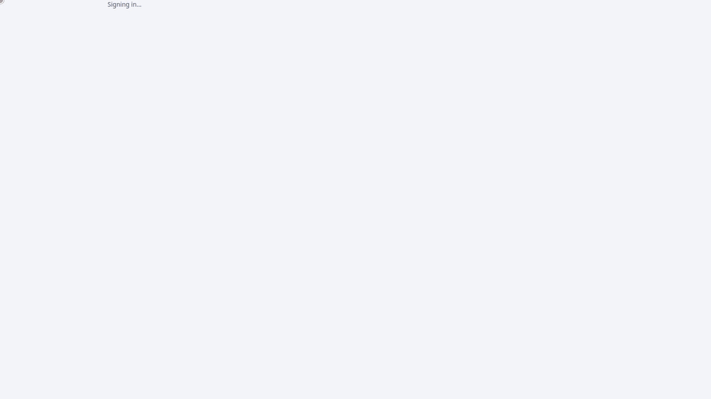

# AgentCanvas documentation

AgentCanvas is a visual builder for AI agents and agentic workflows: you draw a workflow on a canvas and AgentCanvas
turns it into a real project for the framework you pick, which you can run, debug, test, export and deploy.

- **[User guide](user-guide/index.md):** for people who build workflows, and for whoever runs AgentCanvas for a team
  (installing, settings, operations).
- **[Developer documentation](developer/README.md):** for people who change AgentCanvas: setup and conventions, the
  status and roadmap, the build guide, the specification and the architecture decisions.
