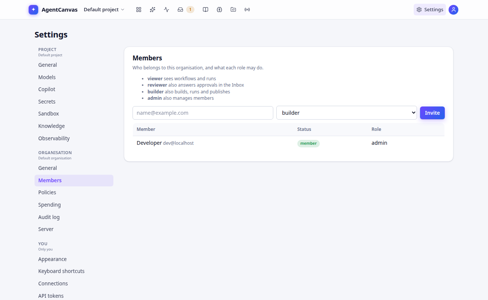
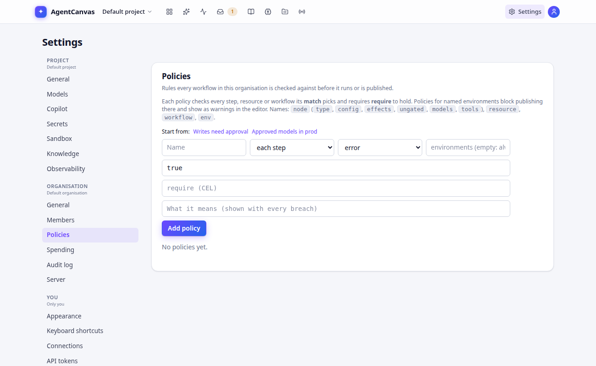

# Organisations, roles and policies

## Signing in

In production AgentCanvas signs people in through your identity provider: any OpenID Connect provider that issues
signed JWT access tokens for the AgentCanvas API (Keycloak, Okta, Entra ID, Auth0, Dex…). Google's own sign-in issues
opaque access tokens and cannot be used directly: put a broker in front (Keycloak, Auth0 or Dex with Google as its
upstream). The administrator configures it once (see [Deploy and operate](deploy.md#sign-in));
people then click through to their usual login page. Sessions renew silently. The top bar shows who you are and
your role, with **Sign out** (sign in again to use a different account). Signing out, switching account or switching
organisation also clears what the app kept in that browser tab, such as the Playground conversation, so the next
person or organisation does not see it (and it is not sent to their model).

In local mode (`make dev-fake` / `make dev-api` without OIDC) there is no sign-in: you are the built-in admin
`dev@localhost`.

## Organisations

Everything (projects, workflows, runs, secrets, memory, deployments, policies, audit log) belongs to an
organisation, and nobody can see another organisation's data. A person can belong to several organisations:
invitations to someone who already belongs to another organisation wait for them to accept (Home shows a banner),
accepting switches to the new organisation, and AgentCanvas opens the one used last.

## Roles

| Role | Can |
|---|---|
| **viewer** | see workflows and runs |
| **reviewer** | also answer approvals and human-input requests in the Inbox |
| **builder** | also build, run, test and publish workflows |
| **admin** | also manage members, policies, release gates and read the audit log |

Buttons for actions your role can't take are hidden.

Everyone has a role in the organisation, and may have a different one in some projects (see
[Projects and their members](#projects-and-their-members)). The organisation role decides the organisation's own
pages; the project role decides everything inside the project:

| What | Decided by | Needs |
|---|---|---|
| Seeing a project's workflows, runs, conversations, datasets, files and deployments | project role | viewer |
| Answering its Inbox items and review queues | project role | reviewer |
| Building, running, testing and publishing its workflows; its secrets, files, sandbox and models | project role | builder |
| Its release gates, publishing over a failed gate, its members and its [spending caps](settings.md#spending-caps) | project role | admin |
| Renaming or deleting a project, moving it to another workspace, sending its traces elsewhere | organisation role | admin |
| Creating a project | organisation role | builder |
| Members, policies, security, notifications, spending, audit log, SCIM, single sign-on groups, the organisation's data | organisation role | admin |
| Making API tokens | organisation role | any (a token's role is at most yours) |

## Projects and their members

By default every member of the organisation sees every project, with their organisation role. A project can also have
**members** of its own: people of the organisation, or groups your identity provider pushes over
[SCIM](#provisioning-from-your-directory-scim), each with a role in that project. Its admins (and the organisation's) manage them in
**Settings › Project › Members**: type an email (someone already in the organisation) or a SCIM group's name, pick a
role and click **Add**; change a role in the list, or **Remove** someone. On the API,
`PUT /v1/projects/{id}/members {"email": "ana@example.com", "role": "builder"}` adds someone already in the
organisation, or changes their role (`{"group": "Support", "role": "reviewer"}` for a SCIM group, by its name);
`GET /v1/projects/{id}/members` lists them and `DELETE /v1/projects/{id}/members/{member id}` removes one.

What a membership gives depends on the organisation's setting **Projects are private** (Settings › Organisation ›
Security, or `security.private_projects` of `PUT /v1/org/settings`):

- **Off** (the default; existing installations stay as they were): everyone sees every project with their
  organisation role, and a project membership can only **raise** it there. An organisation viewer who is a builder of
  one project builds there and only reads the others.
- **On**: organisation admins see every project, as admins. Anyone else sees only the projects they are a member of,
  directly or through a SCIM group, with the **highest** of those memberships as their role there. Every other
  project, and everything in it (workflows, runs, conversations, deployments, secrets, files, datasets, Inbox items),
  answers as if it did not exist, in the app and on the API. The project picker, the Runs page and the Inbox list only
  what they see, and [approval notifications](settings.md#approval-notifications) e-mailed to the people who may decide
  go only to those who see the project, by their role there (the organisation's team address, Slack channel and
  webhook still get every project's, as their admin chose).

A project role may be **above** the person's organisation role: an organisation viewer can be the admin of one
project. It applies to that project only; the organisation's pages keep the organisation role. A personal API token
never does more than the role it was made with, in any project.

- Whoever creates a project while projects are private becomes its admin; otherwise they could not see it.
- Before switching it on, add each team to its projects: people who belong to no project then see none (the app says
  so) until an admin adds them.
- Someone removed from the organisation leaves its projects too: inviting them back gives them none of their old
  project memberships. A SCIM group removed by the provider takes its memberships with it, and leaving a group takes
  what it gave. Invitations can be added to projects before the person first signs in.
- Adding, changing and removing members are in the audit log (`put_project_member`, `delete_project_member`) and
  forwarded with the other security events; so is switching the setting (`put_org_settings`). Changing project
  members and opening every project again need a real sign-in (an API token cannot).
- Groups are SCIM groups: groups that only appear in the sign-in token's claim (see [Roles from groups](#roles-from-groups))
  cannot be added to a project.
- In Matura mode, who sees what comes from Matura: project members and private projects are not offered.

## Members



Admins open **Settings › Members**, enter an email, pick a role and click **Invite**. The invitation takes effect at the person's
first sign-in with that (verified) email. Admins can change roles or remove people. An organisation can never be left without an admin who
has signed in.

Removing someone keeps their account (name and email) and what they made. To **erase** a person instead (a request
under GDPR Art. 17), an admin clicks **Erase…** next to them, gives the request as the reason and says whether
their conversations go too (`POST /v1/org/members/{user_id}/erase`, signed in: an API token cannot): they are removed, their API tokens and app-connector sign-ins go, and so do their
long-term memories (every memory namespace that carries their user id) and Copilot chats. With
`"conversations": true` the conversations they started and the files they attached go too; otherwise those stay
with the project. When they belong to no other organisation their account is pseudonymised: email, name and
preferences are removed and their next sign-in makes a new account. The audit log keeps their user id, which then
leads to no one. The answer and the audit entry give the counts. Someone already removed can be erased the same
way, as long as they belong to no other organisation. You cannot erase yourself; with Matura, people are removed
in Matura.

Everyone can download their own data as JSON under **Settings › Your data** (`GET /v1/me/export`), and an admin
can download a member's with **Export data** next to them (`GET /v1/org/members/{user_id}/export`) (see [Your data](security.md#your-data)); both are recorded in the audit log.

To bootstrap a new install, list the first admins' emails in `AGENTCANVAS_BOOTSTRAP_ADMIN_EMAILS`; they become
admins of the default organisation on first sign-in.

## API tokens

For scripts and CI, anyone can make **personal API tokens** under **Settings › You › API tokens**: give it a name,
pick a role (at most your own) and an expiry (30 days, 90 days, a year or never), then **Create token**. The token
(`act_…`) is shown once: copy it then. Send it as `Authorization: Bearer act_…` to the API, exactly where a signed-in
browser sends its sign-in token:

```bash
curl -H "Authorization: Bearer act_…" https://<your AgentCanvas>/api/v1/projects
```

- A token acts as you, in the organisation you made it in only (`X-Org-Id` naming another one is refused), and with
  the lower of its role and your role now: demoting you demotes your tokens, removing you from the organisation
  stops them.
- Only a fingerprint (SHA-256) of the token is stored. Revoke a token there and it stops working at once; admins see
  everyone's tokens in the same place and can revoke any of them.
- A token cannot make another token, the organisation's SCIM token, invite or remove members, or change which groups
  give which roles: those need a real sign-in, so a leaked token cannot leave access behind that outlives revoking
  it.
- An admin can cap how long tokens live (**Settings › Organisation › General › Limits and policies › Longest API
  token lifetime**), and the operator can set a ceiling for every organisation (`AGENTCANVAS_MAX_TOKEN_DAYS`). With a
  cap, a new token must expire within it (**Never** is not offered); tokens made before keep their expiry, so revoke
  any that live longer.
- Every change made with a token is in the audit log under your name, with the token's id (`personal token tok_…`);
  making and revoking tokens are recorded too.

Deployment keys are different: they belong to a published workflow and can only run it (see
[Publish](publish.md)).

## Roles from groups

Where people sign in with OpenID Connect, an admin can let the identity provider decide roles. Under **Settings ›
Organisation › General › Single sign-on groups** name the claim that carries the groups (`groups` by default; a dotted
name such as `realm_access.roles` reaches a nested claim), and list which role each group gives. At every sign-in:

- the strongest role among the person's mapped groups is their role, replacing one set by hand under Members;
- someone in a mapped group who was invited joins at once, with no invitation to accept;
- someone in a mapped group who is not a member or an invitee joins only on a server with a single organisation, or
  when the operator sets `AGENTCANVAS_SSO_GROUPS_ADD_MEMBERS=true`. With several organisations one organisation's table
  must not enrol people another organisation brought (an admin could map a claim every token carries);
- a token with none of the mapped groups **keeps** the person's role (the default), or **removes** them from the
  organisation if you choose that;
- a change that would leave the organisation without an admin who has signed in is skipped, so the provider can
  never lock you out of your own organisation.

Each change is in the audit log (`sso_role_sync`, `sso_member_removed`). Clear the table to manage roles under Members
again. In Matura mode roles come from Matura and this setting is not offered.

## Provisioning from your directory (SCIM)

Where people sign in with OpenID Connect, an admin can let the identity provider keep the member list in step with the
directory over **SCIM 2.0** (Okta, Entra ID, OneLogin and others). Under **Settings › Organisation › General ›
Provisioning**, **Create token**, copy it (it is shown once) and give it to the provider as a bearer token, with the base
URL shown there (`https://<your AgentCanvas>/api/scim/v2`). **Replace token** stops the old one at once; **Switch off**
turns SCIM off.

What the provider can do:

| In the directory | In AgentCanvas |
|---|---|
| Assign a user to the app | Adds the person (matched by email, `userName`) as a member with the `viewer` role. Someone who already belongs to another organisation still has to accept, as with an invitation. |
| Deactivate a user (`active: false`) | Suspends the membership: no access and their API tokens stop, but nothing is deleted. Reactivating restores it. |
| Remove a user | Removes the membership (the account stays: they may belong to other organisations). |
| Push a group with members | Members get the role the group's **name** has in the groups table (see above); a person in several groups gets the strongest, and `viewer` when none gives one. |
| Remove a group | Its members lose the role it gave. |

Everything is limited to this organisation: the token cannot see or change another one's people. A person nobody
pushes, such as the first admin, keeps their role. Changes the provider asks for that would leave the organisation without
an admin who has signed in are refused for users (the provider shows an error) and skipped for group-driven roles.
Every change is in the audit log without a person, marked `scim`. Supported: `Users` and `Groups` with `GET` (filter
`attribute eq "value"`, `startIndex`, `count`), `POST`, `PUT`, `PATCH` and `DELETE`, and the `ServiceProviderConfig`,
`ResourceTypes` and `Schemas` documents; bulk, sorting and ETags are not. In Matura mode members come from Matura and
SCIM is off.

## Allowed networks

An admin can limit where the organisation can be used from: **Settings › Organisation › Security › Allowed
networks** takes one address (`203.0.113.7`) or network (`203.0.113.0/24`, IPv6 too) per line, up to 100. With a list,
every request that acts in the organisation must come from one of them, whatever it carries: a person's sign-in, a
personal API token, a deployment key (also over MCP and A2A), a share link or the SCIM token. Anything else gets
`403` with the address it came from (problem type `…/errors/network-not-allowed`). An empty list, the default,
accepts any address. Webhook triggers are not covered: the services that send them do not have fixed addresses, and
their signature already proves who sent them.

- The page shows **your address** as the server sees it, and saving a list that leaves it out is refused, so an
  admin cannot lock themselves out by mistake.
- A request outside the list is refused before its key or token is checked, so keys cannot be tried from outside.
- Other organisations on the same server are not affected; a person in several organisations is limited only while
  acting in the one with the list.
- The address is the one the audit log records. With a load balancer in front of AgentCanvas, the operator lists it
  in `TRUSTED_PROXIES`, or every request seems to come from it ([Operations](operations.md)).
- Locked out anyway (your address changed)? The operator sets `AGENTCANVAS_IGNORE_ORG_NETWORKS=true` and restarts,
  which switches every organisation's list off (the page says so) until you fix yours; then they unset it.
- Changes are in the audit log (`put_org_settings`).

## Multi-factor sign-in

An admin can require that the organisation's members sign in with a second factor: **Settings › Organisation ›
Security › Members must sign in with a second factor**. While they act in the organisation, a sign-in that does not
count as multi-factor is sent back to the identity provider to sign in again with one; other organisations a person
belongs to are not affected. What counts is the operator's choice (by default, the provider says `mfa` in the token's
`amr`; see [Multi-factor sign-in](deploy.md#multi-factor-sign-in)), and the operator can require it for the whole
server instead.

- To switch it on, sign in with a second factor first: the page refuses (and the box stays off) when your own sign-in
  does not count, so an admin cannot lock the organisation out. An API token cannot switch it on or off.
- Personal API tokens are not affected: they never pass through the identity provider, and they are made from a
  sign-in. Cap their lifetime too (see [API tokens](#api-tokens)) if that matters to you.
- Changes are in the audit log (`put_org_settings`).
- Needs sign-in through an identity provider (OpenID Connect or Matura); in local mode there is none.

## Audit log

**Settings › Audit log** (admins) records every change: who did it, what it touched, when and from where. Approvals record a
hash of exactly what was approved; publishing past a failed release gate records the reason given. Rows are kept
for 400 days by default. The entries are linked by a hash chain, so a changed or deleted entry can be found:
**Check integrity** on the page (or `GET /v1/org/audit/verify`) recomputes the whole log and lists any entry that
does not match ([Audit log](security.md#audit-log)).

## Policies



Policies are organisation rules the editor and publishing enforce. Each policy has:

- a **scope**: *each step*, *each resource*, or *the workflow*;
- a **match** (CEL): which steps or resources it applies to, e.g. `resource.type == "model.chat"`;
- a **require** (CEL): what must hold, e.g. `resource.config.model in ["anthropic:claude-sonnet-5-5"]`;
- a **severity**: *error* or *warning*;
- optional **environments**: limit the rule to publishing to, e.g., `prod`.

Two presets get you started:

| Preset | Rule |
|---|---|
| **Writes need approval** | every step's external writes are gated by a human: `node.effects.all(e, e.effect != "external_write" \|\| e.gated)` |
| **Approved models in prod** | in `prod`, chat models must come from an approved list |

Another rule worth having when builders are not admins: no tool or remote agent may reach your private network (the
database, internal services) unless an admin adds it. Scope *each resource*, match
`resource.type in ["tool.http", "agent.a2a"]`, require
`!has(resource.config.allow_private_network) || !resource.config.allow_private_network`
(and the same with scope *each step* and `node.type == "agent.a2a"` for remote-agent steps).

Names you can use: `node` (`type`, `config`, `effects`, `ungated`, `models`, `tools`), `resource`, `workflow`,
`env`.

Admins can **Switch off** a policy without deleting it. Broken policies show in the editor's Problems dock (`E095`; `W095` for environment-only rules), steps inside
subgraphs included. Draft and debug runs still work, but **publishing** is refused until every applicable policy
holds. Policies check what a workflow is, not what it spends: to limit spending for every run, draft and debug runs
included, set [spending caps](settings.md#spending-caps) for the organisation or a project.
