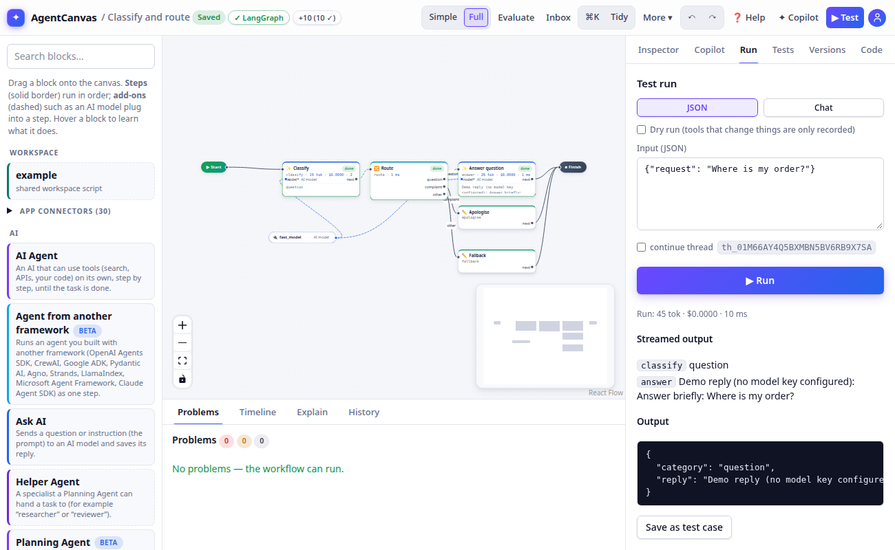

# Building on the canvas

## The editor at a glance

| Area | What it does |
|---|---|
| **Palette** (left) | Every widget, grouped by category, plus your workspace scripts, tools and custom widgets. Type in *Search widgets…* to filter. |
| **Canvas** (middle) | Your workflow. **▶ START** and **■ END** mark where runs begin and finish. Steps are solid cards, resources are dashed boxes. |
| **Toolbar** (top) | **⌘K** command palette, **Tidy** (auto-layout), **Blast radius**, **⧉ Subgraph**, **▭ Frame**, undo ↶ / redo ↷, **▶ Test**, and links to **Evaluate**, **Workspace**, **Memory** and **Inbox**. |
| **Side panel** (right) | **Inspector** (settings of the selection, or the Workflow panel when nothing is selected), **Run**, **Tests**, **Versions**, **Code**. |
| **Dock** (bottom) | **Problems**, **Timeline**, **Explain**. |

**Themes.** The menu under your initial at the right of the top bar picks **Light**, **Medium** (a softer dimmed slate), **Dark**, or **System** (follows your computer). Your choice is kept in this browser and, when you are signed in, with your account, so it follows you to other browsers.

## Add and connect steps

- **Add:** drag a widget from the palette onto the canvas, or use the **⌘K** palette.
- **Connect:** drag from a handle on one card to a handle on another. Step-to-step edges define order;
  resource-to-port edges give a step its model, tools or middleware. Ports are typed and colour-coded (for
  example `model*` takes a *ChatModel*, `tools` takes a list of *Tool*s; `*` means required). A connection that
  doesn't fit is refused with the reason.
- **Configure:** click a card. The Inspector shows its name (used in code and the API), label (shown on the
  card) and a settings form. Prompts and many fields are templates over the state: `{{ state.ticket }}`.
  Conditions (routers, policies, filters) are written in [CEL](https://cel.dev), e.g. `state.urgency == "high"`.
- **Bypass:** **Bypass this node** (under Runtime policies) skips a step and passes the state on unchanged; the
  card shows *· bypassed*. A step that picks the path (**Choose a path**, **Decide with AI**) or a **Repeat for
  each item** still runs when bypassed, or the run could not go on past it. This is the same on every framework
  and in exported code.
- **Select several:** drag a selection box or shift-click. Copy and paste with ⌘C / ⌘V (Ctrl on Windows/Linux).
- **Undo / redo:** ⌘Z and ⇧⌘Z, or the ↶ ↷ buttons.
- **Tidy** lays the graph out automatically.

Everything saves automatically. If someone else saved the same workflow in the meantime, you are told about the
conflict instead of overwriting it.

## State channels

Click an empty spot on the canvas to open the **Workflow** panel. There you set the name, description,
recursion limit (the maximum number of steps per run), **durability** (how eagerly checkpoints are written:
*exit* fastest, *async* default, *sync* for workflows with side effects), **Defaults for every block** (retries,
timeout and cache that a block uses unless it sets its own under Runtime policies; only LangChain flows apply
them), **Hide these fields from traces** (comma-separated field names whose values never reach a trace), a
**budget**, and the **state channels** (see [Core concepts](concepts.md#state-and-channels)). **+ Channel** adds one.

### File and image fields

Pick **file** or **image** as a channel's type for something a person attaches: a screenshot, a photo, a PDF, a
Word document or a text file. *image* takes pictures only (PNG, JPEG, GIF, WebP); *file* takes any of them. In the
Workflow JSON it is an ordinary JSON Schema, `{"type": "object", "format": "file"}` (an image field adds
`"contentMediaType": "image/*"`), so workflows from before file fields open unchanged.

A file field holds a reference to the file, never the file itself:
`{"kind": "file", "id": "fil_…", "name": "invoice.pdf", "media_type": "application/pdf", "size": 48213}`. The file
stays on the server, in the project. Upload one with `POST /v1/projects/{project_id}/uploads` (multipart field `file`)
and put the answer in the run's input. A caller with a deployment key uploads with
`POST /v1/deployments/{id}/files` (multipart field `file`, `Authorization: Bearer <key>`) and puts the answer in the run's
input the same way; the file input's types and the size limit apply. A caller may instead send the bytes inline as
`{"kind": "file", "name": "a.png", "data": "<base64>"}`, which the server stores before the run starts, so
conversations keep only the reference.

- A file is at most 10 MB (`AGENTCANVAS_MAX_UPLOAD_MB`). Its type is read from its content, not from its name: a
  `.png` that is really a web page is kept as plain text. Other kinds of file (archives, programs) are refused.
- Files are kept as long as conversations: one that no run has used for the organisation's conversation retention
  (90 days by default, Settings › Organisation) is deleted, and all of them go with their project.
- Changing a published input field to a file is a breaking change: callers that sent text must send a file now.

### Budgets

A budget stops a run that spends too much: maximum tokens, cost (USD, from model prices: the catalog prices the Claude and OpenAI models, an operator adds others with `AGENTCANVAS_MODEL_PRICES`) or seconds per run,
and maximum tokens or cost per thread (all runs of a conversation together).

A workflow can also have a **day** and a **month** budget in USD: all its runs together, per UTC day and calendar
month (editor runs, deployments, schedules and experiments alike). When the workflow has spent its day or month
budget, runs stop and new runs do not start until the next day or month. **Alert at** raises a cost alert when
spending reaches a share of the day or month budget (80% unless you set other percents, e.g. `50, 90`); reaching the
budget always raises one. Each alert is raised once per period: it shows in the run that crossed it, under
**Spending** in the workflow settings, in the server log and as the `agentcanvas_cost_alerts_total` metric (the
Prometheus rules in `infra/observability/alerts.yaml` turn it into a ticket).

**Spending** under the budget shows what the workflow's runs spent today and this month, against the budgets, with
the number of runs, model answers taken from the cache and calls a backup model answered (see
[Models](models.md#backup-models-and-reusing-answers)). Runs still going count what they have spent so far, on
every server, and each run looks at the others' spending after every model call: runs going together can pass a day
or month budget by no more than one model call each. Conversations deleted since, by hand or by the retention
period, still count: deleting them does not reset a budget.

## Structure: subgraphs and frames

- **⧉ Subgraph** (or ⌘G) turns the selected steps into one *Subgraph* step with its own state. Input channels
  are copied in and output channels copied back. Double-click to work inside it.
- **▭ Frame** draws a labelled box around the selected steps. It is purely visual.

## Who else is here

When someone else has the same workflow open, round avatars with their initials appear in the top bar (hover for the
name and the block they are selecting; click to jump to that block), and a small coloured badge marks the block each
person has selected on the canvas. The same person in two tabs counts once. Viewers show up too.

Presence only tells you who is here: there is no live co-editing. Edits are still saved one batch at a time against
the version you loaded, and if someone else saved first the editor reloads the latest version and puts your edits on
top, as before. When another person's tab reports a newer version than yours, a notice says *Ada saved a newer
version (v7; you have v6)* with an **Update** button, so you see their change before you make a conflicting one.

Presence needs no setup: each open editor sends a heartbeat every ten seconds and listens on a small event stream,
and a tab that closes or stops beating disappears after 30 seconds. A tab in the background keeps its heartbeat but
closes the stream (browsers share a few connections per site among all tabs), and catches up as soon as it is shown. It works across several API servers because the
state is kept in the database.

## Problems

The Problems dock validates the workflow continuously. Codes starting with **E** are errors (the workflow can't
run until they are fixed), **W** are warnings, **I** are hints. Click a problem to jump to the step it is about.
Organisation [policies](accounts.md#policies) show up here too (`E095`, or `W095` for rules that only apply in
one environment).

## Blast radius

**Blast radius** colours every step by what it can do to the outside world (write, send, execute, spend) and
whether a human approves it first. Use it before publishing to spot ungated side effects. A **dry run** (Run tab)
replaces every risky tool with a recorder so you can run the whole workflow safely.

## Generated code

The **Code** tab shows the LangGraph Python program generated from the canvas. Each block is tagged with the card
it came from (`# ── @canvas-node … ──`). It is read-only: change the canvas and the code follows. To take the code
away, use **Export** (see [Export and deploy](export.md#export)).
