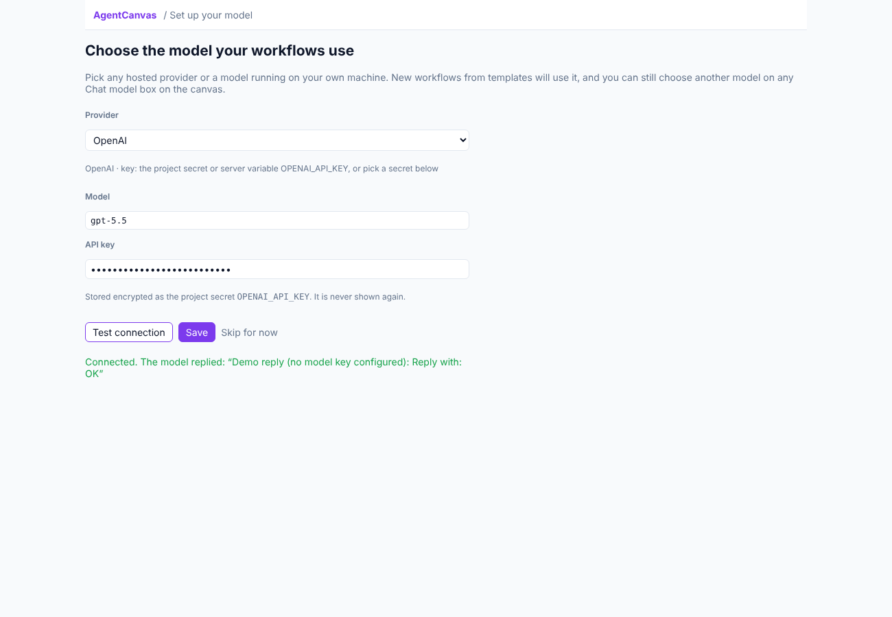

# Models and API keys

AgentCanvas works with any major model provider and with models running on your own computer. You choose a
default model once on the first-run screen, and any **Chat model** box on the canvas can use a different one.

## Supported providers

A model is written `provider:model`. Type it in a Chat model's **Model** field (suggestions are listed), or pick it
on the **Model** screen.

| Provider | Example model id | API key (project secret or server variable) |
|---|---|---|
| Anthropic | `anthropic:claude-sonnet-5-5` | `ANTHROPIC_API_KEY` |
| OpenAI | `openai:gpt-5.5` | `OPENAI_API_KEY` |
| Azure OpenAI | `azure_openai:<deployment>` | `AZURE_OPENAI_API_KEY` (plus endpoint and API version) |
| Google Gemini | `google_genai:gemini-2.5-flash` | `GOOGLE_API_KEY` |
| Mistral AI | `mistralai:mistral-large-latest` | `MISTRAL_API_KEY` |
| Groq | `groq:llama-3.3-70b-versatile` | `GROQ_API_KEY` |
| DeepSeek | `deepseek:deepseek-chat` | `DEEPSEEK_API_KEY` |
| xAI | `xai:grok-4` | `XAI_API_KEY` |
| Any OpenAI-compatible API (OpenRouter, Together, Fireworks, a gateway…) | `openai_compatible:<model>` | `OPENAI_COMPATIBLE_API_KEY`, or a secret you pick; a **Base URL** is required |

### Models on your computer

| Server | Example model id | Default address |
|---|---|---|
| [Ollama](https://ollama.com) | `ollama:llama3.3`, `ollama:qwen3`, `ollama:gpt-oss:20b` | `http://localhost:11434` |
| [LM Studio](https://lmstudio.ai) | `lmstudio:<model loaded in LM Studio>` | `http://localhost:1234/v1` |
| [vLLM](https://docs.vllm.ai) | `vllm:<served model name>` | `http://localhost:8000/v1` |
| [llama.cpp server](https://github.com/ggml-org/llama.cpp) | `llamacpp:<model>` | `http://localhost:8080/v1` |

Local models need no key. Set **Base URL** only when the server is not on its default address (the vLLM default
port 8000 is also the AgentCanvas API's in development, so run vLLM on another port and set the Base URL). Start the
server and load or pull the model before running a workflow. Local models vary in how well they call tools and
produce structured output: if an agent misbehaves, try a larger model.

When AgentCanvas runs in Docker, `localhost` is the container itself: local servers are reached through
`host.docker.internal` automatically (`AGENTCANVAS_LOCAL_MODELS_HOST`).

Any other provider LangChain's `init_chat_model` supports can be used by its prefix too (for example
`bedrock_converse:`), once its integration package is installed on the server; the editor then warns that the
model is not in the catalog (`W010`).

## Where a model's API key comes from

For each Chat model, the first of these that exists is used:

1. The **API key (secret reference)** field of that Chat model: pick any project secret by name.
2. The **project secret named after the provider**, for example `OPENAI_API_KEY`. The first-run screen saves the key
   you enter under this name; you can also add it on the **Workspace** page under **Secrets**.
3. The **server's environment variable** of the same name (set when the server was started).

So one key entered on the first-run screen serves every model of that provider in the project, and a single model
can still use another key (a second account, a customer's key) through its own secret reference.

Keys are stored encrypted, never shown again, and masked as `***` in run events and traces. Exported projects read
them from environment variables with the same names (listed in the export's `.env.example`).

## The first-run screen

Open it from **Choose a model** on Home (until setup is done) or **Model** in the top bar.

1. Pick a provider and a model.
2. Enter the API key, or the server address for a local server on a non-default port.
3. **Test connection** sends one short message with exactly these settings and shows the reply or the error.
   Nothing is saved yet.
4. **Save** stores the key as a project secret and the model as the project's **default model**. Workflows you
   create from templates afterwards use it instead of the template's own models (their other settings, such as
   temperature, are kept). Existing workflows don't change.

**Skip for now** hides the prompt; templates then keep their own models.

## Checks in the editor

| Code | Meaning |
|---|---|
| `W010` | The model is not in the catalog, so its tool calling and structured-output support are not checked. It still runs. |
| `W011` | The provider's integration is not installed on this server. Install the package named in the message. |
| `E017` | An OpenAI-compatible model has no Base URL. |

Under the Model field, a hint names the provider, where its key comes from, and its default address.

## LLM judges and simulated users

Evaluators that use a model (LLM judge, pairwise judge) and simulated users accept any catalog model or any
`provider:model` of a known provider, local ones included, so you can evaluate with a model on your own machine.
They use the project's keys the same way.
