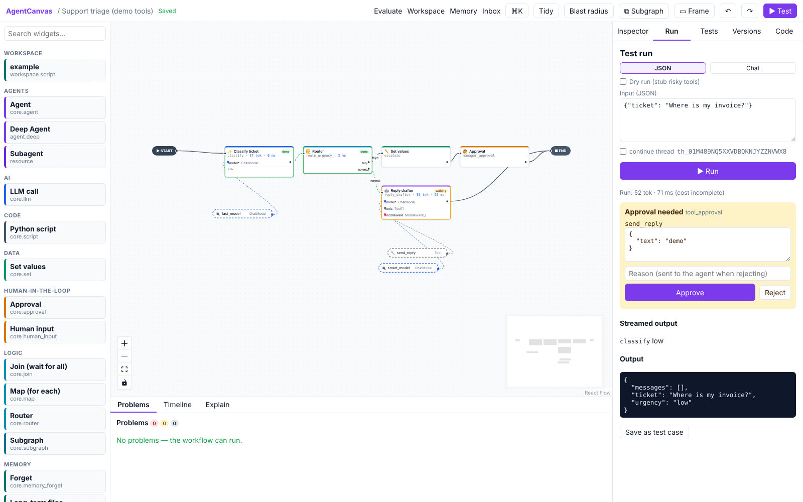

# Running and debugging

## Run a workflow

Open the **Run** tab (or click **▶ Test** in the toolbar).

- **JSON** mode: edit the input (pre-filled with the workflow's input channels) and click **▶ Run**.
- **Chat** mode: for workflows built around the `messages` channel. Type a message and **Send**; each message
  continues the same conversation (thread).
- **File and image inputs**: a workflow input typed *file* or *image* ([File and image fields](canvas.md#file-and-image-fields))
  gets a box under the JSON: **Attach a file** or drop one on it. Images show a preview; the box refuses a file that is
  too large or the wrong kind before sending it, and the server checks what the file really is. The run input then
  holds a reference to the file, not the file. Remove it with ✕.
- **continue thread**: tick it to run on the previous thread, keeping its state, instead of starting fresh.
- **Dry run (stub risky tools)**: every tool that can write, send, execute or spend is replaced by a recorder, so
  the run has no side effects. The output shows what would have been called.

While a run streams, each card shows its status (running, *done*, interrupted, failed) and, when finished, its
tokens and time. The Run tab shows streamed output, the run's totals (tokens, latency, cost when the model has
catalog prices), and the final state as JSON.

## Human decisions

When a run reaches an **Ask for approval** or **Ask a person** step, or an agent tool call that needs approval, it pauses
and the Run tab shows **Approval needed** with the value under review.

- **Approve** or **Reject**. Approvals can also edit the value before approving.
- Paused runs are durable: you can close the browser or restart the server and resume later. A decision nobody
  gives within 90 days (the operator's `AGENTCANVAS_APPROVAL_EXPIRY_DAYS`) expires: the run is cancelled with
  *the approval expired*, the item leaves the Inbox, and the conversation is then deleted with the others once the
  organisation's retention has passed. A step can escalate instead ([Who may decide](#who-may-decide)).
- The **Inbox** (top bar) lists every pending decision across all workflows you can see, so reviewers don't need
  to open the editor. Reviewers (and above) can answer. An admin can have the people who may decide told by e-mail,
  in a Slack channel or through a webhook, with a link to the item ([Approval notifications](settings.md#approval-notifications)).
- By default you may approve a run you started yourself. For a four-eyes control (payments, outbound email,
  destructive tools), an admin turns **Approving your own runs** off under **Settings › Organisation › General ›
  Limits and policies** (the operator can turn it off for every organisation with
  `AGENTCANVAS_APPROVE_OWN_RUNS=false`). Then the person who started a run cannot
  approve or answer what it asks, in the Run tab, the Inbox or through the API: another reviewer must. An answer
  continues the request of the person who asked, so the approver of one step may approve the next one too. Runs of
  a published deployment (API keys, share links) are answered by their callers as before, unless the step names who
  decides it (below).

### Several pauses at once

Steps on parallel branches can pause together, for example two **Ask for approval** steps side by side. Each one is
its own Inbox item and is answered on its own, in either order. Each branch goes on as soon as its step is answered,
and the run finishes after the last answer. An answer always names the pause it is for (its `interrupt_id`, which is
listed in the run's `interrupts` and on the Inbox item), so it can never reach the other pause:

- The Inbox and the Run tab name the pause for you.
- `POST /v1/threads/{thread}/resume` and the deployment API's `POST /v1/deployments/{id}/threads/{thread}/resume`
  take `interrupt_id`. You may leave it out only while one pause waits. With two or more waiting, a request without
  it is refused (409) with the waiting ids in `pending`, and nothing runs.
- An MCP client's `answer` tool takes `interrupt_id` the same way. A client that shows forms is asked about one pause
  at a time.
- An A2A reply names the pause in a data part, `{"interrupt_id": "..."}`. The task's status message lists the ids.
- The share-link page sends the id of the question the visitor answers. An event handler passes it with
  `act.resume(thread_id, value, interrupt_id=event.data["interrupt_id"])`; the `interrupt.raised` event carries it.
- An answer for a pause that is no longer waiting is refused: 404 for an unknown id, 409 for one already decided.
  On LangGraph workflows the engine checks this as well (strict resume). An answer it cannot place fails the run
  with *the answer is for a question this conversation no longer asks*. Nothing is applied, and the item goes back
  to the Inbox.

The other frameworks ask one question at a time even when steps run in parallel, so the same calls work there
unchanged.

### Who may decide

Each **Ask for approval** and **Ask a person** step, and each **AI Agent** and **Planning Agent** with tools that need
approval, has a **Who may decide** section in the Inspector (for agents: *Who may approve its tool calls*). Left
empty, nothing changes: anyone with the reviewer role or above decides it in the Inbox or the Run tab, and on a
published workflow so does its caller. Fill it in to send the decision to particular people:

- **Roles**: members with one of the ticked roles (reviewer, builder, admin; tick each one you mean).
- **Groups**: members of these groups, by name, as your identity provider keeps them over SCIM
  ([Accounts](accounts.md#provisioning-from-your-directory-scim)); the name is matched ignoring case.
- **People**: members by email address; the field suggests your organisation's members. A person still needs the
  reviewer role or above to answer the Inbox.
- **Whoever calls the published workflow may answer too**: by default a step that names roles, groups or people
  is decided only by them, in AgentCanvas. The deployment's key (`POST /v1/deployments/{id}/threads/{thread}/resume`),
  an MCP client's `answer`, an A2A reply, a share-link visitor and an event handler's `act.resume` are refused with
  *decided by the people its workflow names, in the AgentCanvas Inbox*, and the run keeps waiting there. Tick it to
  let the caller answer as well. This matters for AI clients: without it, an agent calling your workflow over MCP or
  A2A cannot approve its own action.
- **Not the person who started the run**: four eyes for this one step, whatever the organisation's setting. The
  caller of a published workflow started its run, so this also keeps the caller from answering (the two boxes
  together are an error, E037).
- **If nobody decides in time, escalate to** a role, after **Escalate after (hours)** or, left empty, when the
  approval would expire (the operator's `AGENTCANVAS_APPROVAL_EXPIRY_DAYS`, 90 days). Members with that role may then
  decide it as well, the Inbox lists it with them (*Decided by: admin role; lee@example.com*), they are notified
  ([Approval notifications](settings.md#approval-notifications)), and the audit log records `approval_escalated`.
  The run is not cancelled: the item gets a full expiry period from the escalation, and only then expires. An item
  escalates once. Without an escalation role the run is cancelled at the expiry, as before.

A step's setting is saved with the pause when the run stops there, so editing the workflow later does not change who
decides a pause that already waits. In the Inbox each item says who decides it (*Decided by: admin role; group
Finance*) and, when you cannot, why; its buttons are then off. A helper agent's tool approvals follow the setting of its
Planning Agent. Steps inside a subgraph keep their own setting. AgentCanvas checks it; code exported from the workflow
does not (I011).

## Waiting runs

A run that reaches a [Wait](widgets.md#wait) step pauses until its time comes or its event arrives, then continues on
its own. Nothing runs while it waits: no server, model or connection is held, and the wait survives restarts and
redeploys. Every API server checks every few seconds for waits that are due, and each wait is continued by exactly one
of them; the run goes on with the workflow version it paused on, as the person who started it (while they are still a
member of the organisation).

- **Nobody answers a wait.** Unlike an approval, a Wait step cannot be decided in the Run tab, the Inbox or through the
  API (409): only its time or its event ends it. A new message on the conversation leaves the wait behind: it ends
  and never wakes the run that moved on.
- **Events.** Send the event to the project, `POST /v1/projects/{project}/events` with
  `{"type": "invoice.paid", "data": {"key": "INV-42", ...}}`, or from a run or an event handler (`emit`). The waits in
  that project for that type, with that key (or with none), continue with the event; the response lists the runs it
  continued under `woke`. Events of another project never reach them. A wait whose conversation is running something
  else at that moment keeps waiting for its time limit.
- **Test runs do not wait.** Saved test cases, experiments, Copilot test runs and dry runs pass through Wait steps at
  once (an event wait counts as timed out), with `skipped: true` in what the step saves. To try the event path, pin
  the Wait step's output.
- **Stop.** The Run tab and the Inbox show the step as **Waiting** (not for a person), with what it waits for and
  until when, in your time. A builder's **■ Stop waiting** there (or `POST /v1/runs/{run_id}/cancel`, or a
  deployment's cancel) ends the wait and cancels the run, and the organisation's [kill switch](settings.md) cancels the
  waiting runs in its scope too; nothing wakes them later.
- **Callers.** Nobody is notified about a wait: there is nothing to decide. Through a
  deployment's API, MCP or A2A, a run at a Wait step comes back `interrupted` with an interrupt of kind `timer` (its
  `payload` says `due_at`, and `event` and `key` for an event wait); the caller cannot answer it and reads the result
  later. An MCP or A2A task stays *working* meanwhile, and cancelling it stops the run. A share link's visitor is told
  the conversation continues on its own.
- **Retention.** A waiting conversation is kept until its wait is due, however far away that is (at most a year); the
  approval expiry (90 days) counts from the due time, so a run the server never managed to continue is cancelled then.
- If the run cannot continue when due (the workflow draft has errors, the organisation is at a spending cap), it is
  tried again every few minutes; if its workflow or deployment is gone, the run is cancelled with the reason.
- **Exports** run the same step, but the exported service has no timer job: your scheduler resumes the conversation
  at `due_at` (`POST .../threads/{thread}/resume` with `{"value": {"timed_out": false, "event": null}}`, or the event).

## Breakpoints

Select a step and click **○ Add breakpoint** in the Inspector. A run pauses *before* that step
(*Paused at a breakpoint before …*); inspect the state, then **⏵ Continue**.

## History

The **History** tab of the editor's dock lists this workflow's past conversations, newest first, with their status;
click one to open it in the **Timeline**. The project's conversations of every workflow are on the **Runs** page
([Settings and moving around](settings.md#your-workflows-and-the-runs-page)).

## Timeline: time travel and fork

The **Timeline** tab in the bottom dock lists every checkpoint of the run's thread, numbered by step (the most recent
200; older ones are kept but not listed). Select one to see the state at that moment, including **lineage** (which
step or input last wrote each channel); the state is loaded when you select the checkpoint
(`GET /v1/threads/{id}/checkpoints/{checkpoint_id}`). Edit the state and click
**⑂ Fork from here** to re-run from that point with the change, without touching the original run. This is the
quickest way to try "what if the classifier had said *high*?".

## Trajectory: who did what

The **Timeline** tab has a **Trajectory** view next to **Checkpoints**, and the **Runs** page has a **Trajectory**
button on each conversation. It shows the whole conversation as a tree, one branch per run: the steps that ran,
under a step the model replies and tool calls, the **helper agents** a Planning Agent handed tasks to (with their
own replies and tools), agents of other frameworks that answered, steps inside subflows, and the frames you drew
around steps. Each row shows its time, tokens and a bar placed on the run's timeline; click a row's name to show
that step on the canvas, and the arrow to open arguments, replies and results. Runs are kept with their events,
so the tree works for past runs too; runs from before this version show a note instead.

## Find conversations by meaning

The search box at the top of the **Runs** page finds conversations by what was asked and answered, not by exact
words: *customers asking for a refund* finds a chat that says "I want my money back" when the project's embedding
model understands that. Results are the best run of each conversation, with a snippet; click one to open it in the
Timeline. Narrow it with the workflow filter below.

- Each run is indexed in the background when it finishes, with the project's **embedding** model (Settings >
  Models; the built-in offline embedding when none is chosen, which matches word forms, not synonyms).
- Runs from before this version, and runs indexed with a model you have since replaced, are listed as *not
  searchable yet*; **Index them** (builders) adds them, newest first.
- The index follows your data: deleting a conversation, or the organisation's retention period, removes its search
  entry, and nobody sees another organisation's runs. Secret values are masked before anything is embedded, but with
  a hosted embedding model the masked text of inputs and answers is sent to that provider, as with a knowledge base.

## Explain

The **Explain** tab narrates the run in plain language: which step ran, what each router chose and why
(*chose route 'normal' → reply_drafter*), where it paused. Useful for sharing what happened with someone who
doesn't read JSON.

## Pins and mocks

- **📌 Pin last output:** after a run, select a step and pin its last output. Debug runs then skip that step and replay
  the pinned output: handy for iterating on a later step without re-running an expensive one. **Unpin** to undo.
- **Mock replies:** select a *AI model* block and enter **Mock replies for debug runs**. Debug runs use those
  replies instead of calling the model. The replies follow the conversation: the first answer of a conversation is
  reply 1, the next one reply 2, and the last reply repeats. An agent's tool loop and a chat's later turns move
  through the list, but every **Ask AI** step starts a conversation of its own, so each one gets reply 1. To script
  two Ask AI steps differently, give each its own AI model block.

Pins and mocks only affect runs started from the editor, never published deployments.

## Cost and budgets

Each step shows tokens and latency; the run panel shows totals, how many answers came from a model's cache
(*cached*) and how many a backup model gave (*by backup model*). Set a [budget](canvas.md#budgets) to stop runs
that exceed tokens, cost or time, or a day or month budget for all runs of the workflow; a cost alert shows as a
warning in the run that crossed it.

## Tracing

With `LANGSMITH_TRACING=true` and a `LANGSMITH_API_KEY` on the server, each run gets an **Open trace in LangSmith**
link. With `OTEL_EXPORTER_OTLP_ENDPOINT` set, the server also exports OpenTelemetry traces. Secret values are
masked as `***`; list fields under **Hide these fields from traces** in the Workflow panel to keep their values out of traces entirely.

## Save a run as a test

After a run, **Save as test case** in the Run tab records the input and the expected status, route and output.
The **Tests** tab runs all saved cases (**▶ Run tests**) against the draft or any version. **Record as test**
turns a recorded run (including a production run) into a deterministic regression test that replays the model
and tool answers instead of calling them. See [Publish and integrate](publish.md#tests-before-you-ship).
