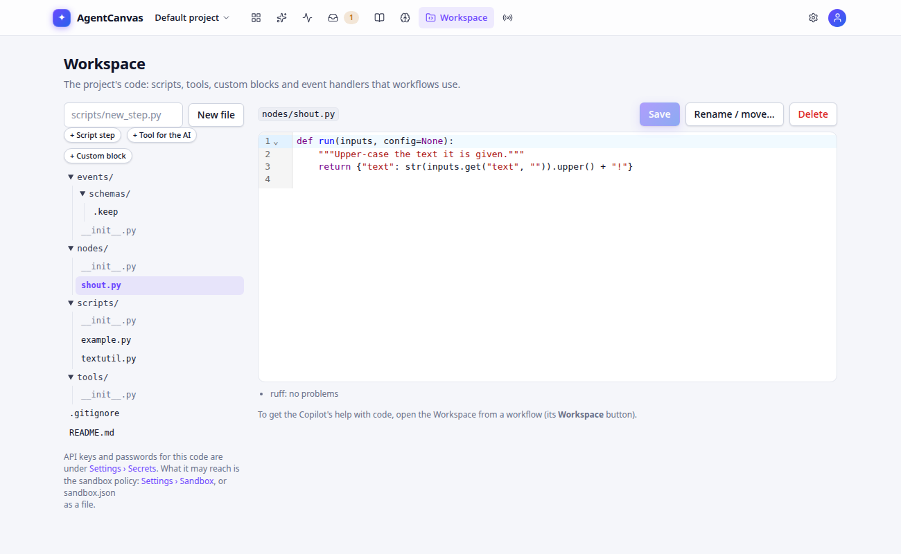

# Workspace: code, secrets and events

Each project has a **workspace**: a git repository of Python code used by its workflows. Open it from the
**Workspace** link in the top bar.



| Folder | What goes there | Appears as |
|---|---|---|
| `scripts/` | Script functions `def run(state: dict) -> dict` (sync or async) | *Workspace scripts* in the palette; use with the **Python script** widget |
| `tools/` | LangChain `@tool` functions | *Python tool* resources for agents |
| `nodes/` | Custom widgets declared with `@canvas_node(...)` | New widgets in the palette, in the category you choose |
| `events/` | Event handlers declared with `@on("type")`; JSON schemas in `events/schemas/` | The **Events** page |

Click a file to edit it (with lint markers), **New** to add one. Every save is a git commit, and a workflow
**version** pins the workspace commit it was made with.

## A script

```python
# scripts/clean.py
def run(state: dict) -> dict:
    text = str(state.get("text") or "")
    return {"text": text.strip()}   # return only the channels you want to update
```

## A tool

```python
# tools/orders.py
from langchain_core.tools import tool

@tool
def order_status(order_id: str) -> str:
    """Look up the status of an order."""
    return "shipped"
```

## A custom widget

```python
# nodes/crm.py
from agentcanvas.sdk import canvas_node

@canvas_node(name="acme.score_lead", label="Score lead", category="CRM", writes=["score"])
def score_lead(state: dict, cfg: dict) -> dict:
    return {"score": 0.8}
```

`config` can be a Pydantic model or a JSON Schema; its fields become the widget's settings form. Declare
`side_effects` so the [blast radius](canvas.md#blast-radius) and policies know what it does.

## Secrets

Store API keys and passwords on the Workspace page under **Secrets** (**Save secret**). Names are
`UPPER_SNAKE_CASE`. Secrets are encrypted at rest, can't be read back through the API, and are masked as `***` in
run events and traces.

- In widget settings: `{"$secret": "NAME"}`, e.g. an HTTP tool's header. A Chat model's **API key** field lets you
  pick a secret by name; a secret named after the provider (`OPENAI_API_KEY`, `GOOGLE_API_KEY`…) is used by that
  provider's models automatically. See [Models and API keys](models.md).
- In scripts and custom widgets: `from agentcanvas.sdk import secret` then `secret("NAME")`.

## Sandbox

Workspace code runs where the server is configured to run it (`AGENTCANVAS_SCRIPT_EXECUTION`): in the API process
(local default), a child process (production default), a Docker container, or a LangSmith Sandbox
(experimental). **Sandbox policy** edits `sandbox.json`: time and memory limits, an outbound network allow-list,
and headers injected into outgoing requests (so code can call an API without seeing its key).

## Events

Events start or resume workflows when something happens elsewhere ("a lead was created", "a payment failed").

```python
# events/leads.py
from agentcanvas.sdk import on

@on("crm.lead.created", filter="event.data.amount > 50000", dedup_key="event.data.lead_id")
def qualify(event, act):
    act.start_workflow("Lead qualification", input={"lead": event.data})
```

Handlers only *describe* actions (`act.start_workflow`, `act.resume`, `act.emit`); the platform performs them, so
handler code never holds credentials. Steps can emit events during a run with `agentcanvas.sdk.emit(type, data)`.

The **Events** page shows the **event map** (which events start or resume which workflows), lets you **Send a
test event** (or **Dry run** it to see what would happen), and keeps an **event log**. Other systems send events
with `POST /v1/projects/{project_id}/events`.
